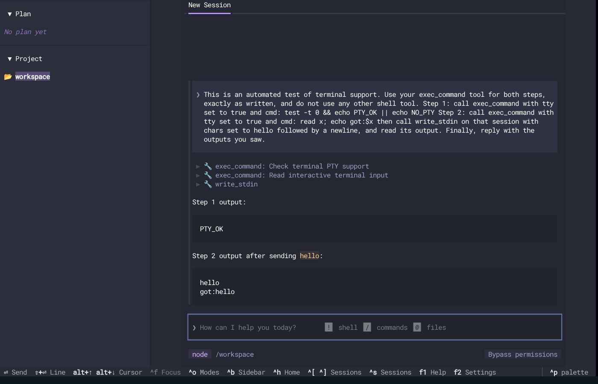

# letta-acp registry listing: end-to-end evidence suite

> **Update 2026-10-31: letta-acp 0.1.8 (the version registry PR 472 pins) was run through the same suite.** It does not hang: every prompt was answered (169 of 169), A 15 of 20, B 5 of 7 with `license_url`, D 27 of 31, and four independent clients finish turns. But the registry's hourly version updater would move the entry to 0.1.11 (a dry run of its own script proposes `0.1.8 -> 0.1.11`), and 0.1.11 hangs. Details: [`RESULTS-0.1.8.md`](RESULTS-0.1.8.md). The rest of this README describes the 0.1.11 run.

**Summary.** This branch holds a live, real-world test suite for listing `letta-acp` in the ACP Registry, exactly as the entry would be listed (`@letta-ai/letta-acp@0.1.11` with `license_url`). It reports four metrics side by side, defined in [`COVERAGE.md`](COVERAGE.md) and generated from the logs into [`COVERAGE-RESULTS.md`](COVERAGE-RESULTS.md): **A** Letta's differentiating features (the headline), **B** the registry's own gates, **C** the platform and install matrix, **D** generic ACP behaviour, including four independent clients. Every result is tagged with the highest validation level it reached (unit, fake app server, real ACP client, live Cloud, live model turn); nothing here reaches *live Cloud*.

**The headline is the published column, and it is not green.** Measured on the local backend with a real model (`openai/gpt-5.6-luna`):

| | published, as listed | lock-pinned (pins users do not get) | node-pty-fix (unreleased) |
|---|---|---|---|
| A. Letta differentiators | **0 of 20** (all blocked: no turn completes) | 16 of 20 | not run |
| B. Registry gates | **4 of 7** | not run | not run |
| D. Generic ACP and clients | **4 of 31** (the model-free ones; 23 blocked, the 3 clients that ran time out, 1 not run) | 25 of 31 | not run |

Three A entries and six D entries are listed as *not covered* and sit outside those denominators. Metric C is in `COVERAGE-RESULTS.md`: published and lock-pinned install only where a C toolchain is present (macOS, Windows and glibc arm64 in CI) and fail to install on the six no-`make` cells (glibc x64 and musl x64 on Node 22 and 24, plus musl arm64 in CI); the fix column installs and completes a live model turn on all four x64 cells and was not run on arm64, macOS or Windows. The lock-pinned column exists to show where the failures come from. Its passes are not what the listing delivers, so the any-chain aggregate in `COVERAGE-RESULTS.md` is labelled for reference only.

What the suite found, each reproduced live and logged under `e2e/logs/`:

- **The published install never completes a prompt turn.** Reply text streams but `session/prompt` does not return (`logs/live/published`, gate G01). The cause is `@letta-ai/letta-agent-sdk` 0.7.8, which a fresh install resolves (letta-acp declares `^0.7.2`, its own lockfile holds 0.7.2); a reviewer isolated the hang to that package alone, with 0.7.2 working under ACP SDK 1.9.0. The lock-pinned chain here pins both SDKs, so its second pin is not what removes the hang. letta-acp's own test suite also fails (17 tests) with newer SDKs on this host (`logs/sdk-drift/`).
- Registry gates R4 and R6 (the registry's no-make Docker image) fail for the entry as listed; R7, one real prompt turn, fails because of the hang.
- **Toad 0.6.20 rejects letta-acp's `tool_call_update` messages with -32602** because `rawOutput` is a string (D20; wire evidence in `logs/clients/k02-toad-permission/wire.ndjson`). Toad's own permission dialog otherwise works (K02).
- A prompt sent immediately after `end_turn` is answered with an empty turn and replies shift by one (D24); the first tool call after a cancel fails "Interrupted by user" (D08b).
- Skills in `.claude/skills` are advertised but not found by the harness (A08b); `/toolset` is advertised but "Unknown command" (A07); `session/set_config_option` echoes `-none` for a requested `-low` variant (D15); a subagent tool call stays `in_progress` (A09b); shell tool kind is `other` (D21); `ApplyPatch` carries no diff (D22).
- Stock images need `git` (and `bash` on Alpine) for the local backend.

**Findings the first version of this suite got wrong, now corrected.** A reviewer found four failures that were test artifacts, not Letta bugs. They are not in the list above.

- *Cross-agent memory guard (A14).* The first version reported another agent's memory as readable and blamed the guard. In letta-code 0.30.28, the version letta-acp 0.1.11 pins, the shell sandbox is opt-in (`LETTA_FS_SANDBOX=1`) and the cross-agent guard skips shell tools by design, so a shell reading another agent's memory is that version's default behaviour. The test also never set the opt-in, its "bwrap on host" check only tested that the file exists, and its `SANDBOX=un` was a regex that stopped at the `s` of `unset`. A14 now runs with the opt-in set, probes whether bwrap can create a user namespace, and passes (the shell was denied, `LETTA_SANDBOX=bwrap`). The default-configuration exposure is recorded in the detail. This says nothing about a security failure; it says the sandbox is off unless the user turns it on.
- *`letta` not on PATH (A10, A15).* The harness launched the adapter by path. The registry launches the entry through `npx`, which puts `letta` on PATH, so A10b and A15b are the results that apply to listing; A10 and A15 are relabelled as the direct-install variant and stay in the denominator. (A10 passed in the latest run and failed in the two before it; it uses a live model.)
- *No PTY (D17).* The first version never asked for `tty: true`, so `NOTTY` was expected. It now asks, and passes where node-pty loads.
- *Published column under-reported.* D01, D02, D18 and D19 need no model but shared scenarios with checks that do, so they showed as blocked. They now run on their own and pass on published.

Every criterion change after the first full results is recorded in `checks.json` under `revisions`; no check was removed from a denominator. The earlier run is kept in `logs/live/earlier-run-efc8424/`.

**Disclosures.**

1. `COVERAGE-RESULTS.md` leads with one column per install chain; the any-chain aggregate (a check passes if any chain passed it) is printed below it for reference only.
2. The R5 and R6 lines of `logs/registry-final/summary.txt` were edited by hand: `protocol_matrix.py` exits 0 even when the agent fails, so the verdict was taken from its `latest.json`.
3. B has no node-pty-fix column. An earlier fix-chain registry run (`logs/head-9b2e784/registry-after.log`, R4 only) used a different entry without `license_url`, so it is not counted. R2's PASS rests on the raw license URL; the entry's `blob` URL returned 403 through this environment's proxy, so its passing on the registry's runners is inferred.
4. The platform cells for arm64, macOS and Windows ran in fork CI with no model key, so they reach *real ACP client* level only, and the fix column has no evidence there. The arm64 cells ran on native arm64 runners. The CI run is [41187004892](https://github.com/mruderman/letta-code/actions/runs/41187004892) (head `5c77029`); its 20 `RESULT_JSON` lines and toolchain lines are saved in `logs/platform/ci-run-41187004892.txt`, because CI logs expire. Every job exits 0 by design, so pass or fail is in the line, not the job colour.
5. The local Docker glibc cells use `node:*-bookworm-slim`, and the musl cells use `node:*-alpine`. They install `git`, and `bash` on Alpine, because the stock images lack them.
6. Live checks are nondeterministic. D05 failed once in an earlier full lock-pinned run and passed three times in isolation (`logs/live/earlier-run-efc8424/lock-pinned-d05-reruns/`); it passed in the latest run. A10 flipped as noted above.
7. K01 to K04 passed on the lock-pinned install. Against the published install, three independent clients (acpx, the Python SDK client, the TypeScript SDK 2.x client) all fail by timeout on their first turn, the same hang seen by the scripted client (`logs/clients/published/`); Toad (K02) was not run there. The first Toad permission attempt failed only because my harness had not passed the placeholder API key; the run counted is the second, and the failed one is kept beside it.
8. A11 waits up to 90 s for the memory write, a wait added after the first full results. A13's evidence is a reflection branch with no commits. D10 passes only when the prompt names the editor-buffer tool. See `COVERAGE.md`, "Known weaknesses".
9. Nothing was sent to any `letta-ai` repository, and no registry change was made. Zed, JetBrains and Obsidian were not run; manual checklist: install the entry's command (`npx @letta-ai/letta-acp@0.1.11`) in the editor's ACP settings, open a throwaway project, send one prompt that runs a shell command, approve the permission dialog, and confirm the reply and tool result render.

Layout: `live/` (runner, scenarios), `checks.json` (fixed denominators), `registry/`, `clients/`, `platform/` with [`.github/workflows/e2e-platform-matrix.yml`](../.github/workflows/e2e-platform-matrix.yml), `chains/make-chains.sh`, and the logs. Reproduction commands are at the end of `COVERAGE.md`.

---

# node-pty prebuild fix — end-to-end evidence

Evidence for [`mruderman/letta-code:fix/node-pty-prebuilds`](https://github.com/mruderman/letta-code/tree/fix/node-pty-prebuilds),
which revives closed letta-ai/letta-code#3608 (fixes letta-ai/letta-acp#50:
`npx @letta-ai/letta-acp` fails on Linux without a C toolchain, which keeps Letta out
of the ACP Registry). This branch holds only test material: the plan
([`TEST-PLAN.md`](TEST-PLAN.md)), reproducible [`scripts/`](scripts/), and scrubbed
[`logs/`](logs/). It shares no history with letta-code and is not meant to be merged.

**Status:** sandbox phase, fork CI and live-agent runs (OpenAI model, incl. Toad) are
complete on the refreshed head `9b2e784`; everything that ran passes, with the
non-credentialed fork CI jobs and the live-run caveats listed below. Not covered, stated
plainly: [what the suite does not test](#not-covered).

## Under test

| Component | Version / ref |
|---|---|
| letta-code (fix) | `fix/node-pty-prebuilds` @ `9b2e784`, rebased on `main` @ `8f72222` (0.34.36); test build published as `0.34.99`. The first sandbox pass (`logs/sandbox/`) ran on the previous head `bb0e02c` (on `e2b62e2`); the rebase only moved the branch over two unrelated upstream commits and recomputed the runtime-graph digest, and checks 1–9 were re-run on `9b2e784` (`logs/head-9b2e784/`) |
| letta-acp | letta-ai `main` @ `4b0a571`, with `@letta-ai/letta-code` → `0.34.99` and `@letta-ai/letta-agent-sdk` → `^0.8.64` (resolved `0.8.65` on the re-run) bumped together; test build `0.1.99` |
| node-pty | `1.2.0-beta.14`, delivered through letta-code's published `npm-shrinkwrap.json` |
| ACP Registry validator | agentclientprotocol/registry `main` @ `b51a879` (first pass: `8c75170`), Letta entry from registry#472 (`a726a80`) |
| Third-party client | Toad `0.6.20` (batrachian.ai) |
| ACP client SDK (scripted client) | `@agentclientprotocol/sdk` `1.3.0` (same as letta-acp) |

Test builds are served from a throwaway Verdaccio where `@letta-ai/letta-code` and
`@letta-ai/letta-acp` exist **only** as the local test versions, so every install is
provably the build under test.

## Results — sandbox phase (no credentials)

| # | Check | Environment | Result | Logs |
|---|---|---|---|---|
| 1 | ACP Registry validator, **published** `letta-acp@0.1.11` | registry image (Ubuntu 24.04, no make, Node 22.23.4) | ✗ fails: `node-pty@1.1.0` install runs `node-gyp rebuild` → `code: 1`; validator reports an initialize timeout | [`registry-before.log`](logs/sandbox/registry-before.log), [npm debug](logs/sandbox/registry-before-npm-debug.log) |
| 2 | ACP Registry validator, **fixed** chain | same | ✓ `Auth OK: letta-login(terminal)` | [`registry-after.log`](logs/sandbox/registry-after.log) |
| 3 | Full ACP pipeline via `npx` (adapter → SDK → app-server → local backend → turn), deterministic executor | registry image (glibc) | ✓ | [`det-glibc/`](logs/sandbox/det-glibc/) |
| 4 | same | `node:22-alpine` (musl) | ✓ | [`det-musl/`](logs/sandbox/det-musl/) |
| 5 | `exec_command` PTY path (`startShellProcess`): real PTY, stdin round-trip | registry image (glibc) | ✓ `tty=true`, `PTY_OK`, `got:hello` | [`pty-smoke-glibc.json`](logs/sandbox/pty-smoke-glibc.json) |
| 6 | Websocket terminal (`handleTerminalSpawn`/`Input`) | registry image (glibc) | ✓ shell evaluated typed `echo TERM_$((40+2))` → `TERM_42` | same file |
| 7 | `exec_command` on musl: glibc prebuild refused | `node:22-alpine` | ✓ `tty=false`, ran via pipe (`NO_PTY`), reason on stderr, no crash | [`pty-smoke-musl.json`](logs/sandbox/pty-smoke-musl.json) |
| 8 | Websocket terminal on musl | `node:22-alpine` | ✓ clean `terminal_exited` naming musl, no segfault | same file |
| 9 | **Toad** (independent ACP client) launches letta-acp, session + prompt turn | registry image | ✓ `end_turn`; screenshot shows prompt and reply | [`toad-det/`](logs/sandbox/toad-det/) |

In every environment above, node-pty installed **from its prebuild** (no `build/`
directory) with **no** `make` or compiler present.


Checks 1–9 were re-run unchanged on `9b2e784` and all pass again; those logs are in
[`logs/head-9b2e784/`](logs/head-9b2e784/) (the first pass stays in `logs/sandbox/`).

## Results — live agent (OpenAI `gpt-5.6-luna`, local backend, fresh agent per run)

Every run creates a fresh agent in an empty `HOME` inside a container; nothing persists.
Model: `openai/gpt-5.6-luna` (Codex toolset: `exec_command`, `write_stdin`). Pass criteria
are applied to the tools' `rawInput`/`rawOutput` in the ACP transcript, not to model prose.

| # | Check | Environment | Result | Logs |
|---|---|---|---|---|
| 10 | letta-acp's own live test (`bun run test:backend:live:local`, the one Letta's CI runs on `main`) against the bumped chain | host, Bun | ✓ listed models, created an agent, received `ACP_LOCAL_OK` | [`live-letta-acp-own-test.out`](logs/head-9b2e784/live-letta-acp-own-test.out) |
| 11 | PTY scenario through ACP, 3 runs | registry image (glibc, no `make`) | ✓ 3/3: `exec_command` with `tty: true` printed `PTY_OK`; `write_stdin` input came back as `got:hello` | [`live-pty-glibc-{1,2,3}/`](logs/head-9b2e784/) |
| 12 | same scenario, 3 runs | `node:22-alpine` (musl) | ✓ 3/3 (see run-1 note): glibc prebuild refused with the actionable message, command still ran through the pipe (`NO_PTY`), turn ended normally, no crash | [`live-pty-musl-{1,2,3}/`](logs/head-9b2e784/) |
| 13 | same scenario in **Toad** (independent client), pre-approved tools | registry image | ✓ `check-wire.mjs` passes on Toad's wire log (3 tool calls); screenshot below | [`live-toad-pty/`](logs/head-9b2e784/live-toad-pty/) |



**Run-1 note (musl).** The first live pass, kept in
[`logs/head-9b2e784/run1-original-criteria/`](logs/head-9b2e784/run1-original-criteria/), went 7/8:
two of three musl runs failed the criterion "`write_stdin` was called". That criterion was
wrong for musl. In the pipe fallback the command has already finished (`read x` returns at
once), so whether the model then calls `write_stdin` is its own choice and says nothing about
the fix; the same transcripts show the fallback message, `NO_PTY` and a normal end of turn.
I removed that check from the musl branch of `acp-client.mjs` and `check-wire.mjs`
(it stays for glibc) and re-ran the whole live suite from scratch: that second run is
8/8 and is the one tabled above. The saved run-1 musl wire logs also pass the corrected checker.

**Permission assertion (added after run 2).** The glibc/musl scripted runs use standard
mode and the client answers `allow_once`. `check-wire.mjs --expect-permission yes` now also
requires that the agent asked for permission to run the TTY probe. It passes on all six
scripted runs, and fails on the Toad run (pre-approved, as a negative control), so it
discriminates. It was applied to the saved wire logs, not baked into the run itself.

## Results — fork CI (draft PR [mruderman/letta-code#3](https://github.com/mruderman/letta-code/pull/3), head `9b2e784`)

61 jobs: 39 passed, 22 failed. Cite these:

| Job | Result |
|---|---|
| Package on macOS arm64, Linux x64, **Linux arm64**, Windows x64 (incl. packaged-local-backend smoke) | ✓ all four |
| Minimal Linux npm artifact check (no toolchain, registry install) | ✓ x64 and arm64 |
| Windows node-pty artifact smoke (after `npm install -g`; shell level, not through ACP) | ✓ |
| Unit tests, every shard, Linux x64 / Linux arm64 / macOS / Windows | ✓ |
| Lint & Type Check, Node 22 Smoke, Update Chain Smoke | ✓ |

The 22 failures are `API / <runner> / <shard>` (20), `OpenCode native lifecycle` and
`Cursor native lifecycle`. One API job's log shows `LETTA_API_KEY` empty and
`Model catalog is unavailable`; the other two fail in their "run native … tests" steps,
which read the `OPENAI_API_KEY` and `CURSOR_API_KEY` secrets; I did not read those two logs.
**Do not cite** the `Headless` and `Headless Local` jobs as evidence: they are green but
vacuous on a fork without secrets (the `Headless Local / openai/gpt-5-mini` log reads
`SKIP: Missing env OPENAI_API_KEY`). The PR could not run CI at first because it conflicted
with fork `main` (GitHub does not start pull-request workflows on a conflicted PR); it was
rebased onto `8f72222` and force-pushed with lease to the fork branch only.

## Coverage map

| What the fix touches | Covered by |
|---|---|
| `npx` install without build tools | 1–4, 9 (and every container run) |
| Published shrinkwrap pins node-pty for consumers | 3–9 install letta-code/letta-acp from the registry, not from source |
| `exec_command` `tty: true` + `write_stdin` | 5, 7; live: 11, 12, 13 |
| Websocket terminal handler | 6, 8 (driven via a recording socket, not a live app-server connection) |
| musl degrades instead of segfaulting | 4, 7, 8 |
| Real model choosing the PTY path through ACP | 11, 12, 13 |
| macOS, Windows ConPTY, linux/arm64 | Letta's CI on the fork (above): Package and minimal-Linux checks on arm64, Windows ConPTY artifact smoke, unit tests on macOS. Arm64 emulation is unavailable in this sandbox (no `binfmt_misc`) |

## Deviations (all test-environment only)

1. **TLS CA layer.** This sandbox intercepts TLS, so the registry image gets one
   extra `COPY` of the sandbox CA bundle ([`25-registry-images.sh`](scripts/25-registry-images.sh)
   prints the exact diff). Skipped automatically when `EXTRA_CA_BUNDLE` is unset.
2. **Verdaccio redirect.** The validator overrides `HOME` and runs
   `npm exec --prefix <sandbox>`, which relocates user and global npm config; only
   npm's builtin config stays put, so the "after" image sets the registry there.
3. **Alpine prerequisites.** `node:22-alpine` lacks `git` and `bash`, which
   letta-code's local backend needs; the musl runs install both. (See findings.)
4. **Terminal handler without transport.** Checks 6 and 8 call the real handler
   functions with a recording socket.
5. **Toad live run pre-approves tools** (`LETTA_ACP_PERMISSION_MODE=unrestricted`)
   so the scripted UI session is not blocked on a dialog; permission prompts are
   exercised by the scripted client instead.
6. **OpenAI key is a proxy-injected network secret.** This session's key never exists as a
   variable; an egress proxy adds it to requests for `api.openai.com`. The scripts send a
   placeholder key (`90-live-all.sh` proves injection by getting HTTP 200 from
   `/v1/models`, which OpenAI would answer with 401 to the placeholder alone). Containers on
   Docker's bridge network bypass that proxy, so live containers use host networking plus the
   proxy variables and `NODE_USE_ENV_PROXY=1`; the Verdaccio host is added to `NO_PROXY`
   explicitly because Node matches it literally (no CIDR ranges). The real key is never
   printed or logged, and `95-collect-logs.sh` scrubs key-shaped strings.

## Findings beyond the fix

- **The published shrinkwrap decides node-pty for consumers.** `main` now publishes
  `npm-shrinkwrap.json`, which still locked `node-pty@1.1.0`; the fix updates that
  entry (4 lines) and the `lettaRuntimeGraphSha512` digest.
- **Alpine needs `git` and `bash` for the local backend** (`spawn git ENOENT`, then
  the memory store's git hook fails with `env: can't execute 'bash'`). Unrelated to
  node-pty; worth a line in docs.
- **`LETTA_LOCAL_BACKEND_EXECUTOR=deterministic` answers `pong` and calls no
  tools** (`DeterministicPongExecutor`), so tool execution through ACP is covered
  by the live runs rather than deterministically.

- **The musl live criterion in the original plan was wrong** (see run-1 note above): a
  model that sees the pipe fallback has no live session to `write_stdin` to.
- **Fork CI green is not always evidence** (see above): jobs that skip for missing secrets
  pass vacuously.
- **A failing unit test on unmodified `main` in this sandbox:** `Bash background tools >
  background timeout force-kills the whole process tree` fails here on both `main` and the
  fix branch (the sandbox has no init process to reap killed descendants, so they linger as
  zombies). It is unrelated; the fork's CI unit jobs were all green.

<a id="not-covered"></a>
## Not covered

- **cloud-oauth with local tools** (Letta's documented default for editors): needs a Letta
  account and is out of scope here. The PTY also runs there; nothing in this suite tests it.
- **Letta behavior beyond the fix:** agent identity and persistence across adapter restarts,
  memory/MemFS, cancel while a PTY session is alive, real approval deny / allow-always, and
  harness-executed slash commands. Every run uses a fresh empty `HOME`, so reuse is
  unreachable by design.
- **Windows through ACP or a live agent**, **macOS** artifact-level checks, **Node 24/26**,
  and clients other than Toad and the scripted client (Zed, JetBrains, Obsidian).
- **Toad's own permission dialog** (its run pre-approves tools).
- **The musl guard is protected only by this suite**, which is not in any CI.

## Reproduce

```bash
export E2E_WORK=/tmp/letta-e2e LETTA_CODE_DIR=~/letta-code LETTA_ACP_DIR=~/letta-acp REGISTRY_DIR=~/acp-registry
# Only in sandboxes that intercept TLS:
# export EXTRA_CA_BUNDLE=/path/to/ca-bundle.crt
bash e2e/scripts/run-sandbox.sh                         # this table's checks 1–9
bash e2e/scripts/90-live-all.sh                          # live-agent runs (placeholder key + egress proxy), or
OPENAI_API_KEY=... bash e2e/scripts/90-live-all.sh       # with a real key
bash e2e/scripts/95-collect-logs.sh <label>             # copy + scrub logs here
```

Clones: letta-code with `fix/node-pty-prebuilds` checked out as a branch, letta-acp
`main`, and agentclientprotocol/registry `main`. Requires Docker, Bun, Node, Python 3.

## Continuing in a new session

Remaining optional work, in rough value order: a cancel-while-PTY-running test, an identity
and memory round trip across adapter restarts, a real approval deny / allow-always test
(assert the denied command did not run), and pinning the Codex-toolset presentation in
letta-acp. See "Not covered".

To re-run: clone `mruderman/letta-code` (branches `fix/node-pty-prebuilds` and
`e2e-evidence`), `letta-ai/letta-acp` and `agentclientprotocol/registry` (fetch
`pull/472/head` as `pr-472`); start Docker; set the env above; run `run-sandbox.sh`, then
`90-live-all.sh` (it uses a real key if one is in the environment, otherwise a placeholder
when an egress proxy injects it, and stops if OpenAI rejects the result); then
`95-collect-logs.sh <label>`.

Ground rules: nothing is posted to any `letta-ai` repository; every live run creates a fresh
agent in a throwaway directory; failures are reported as failures.
