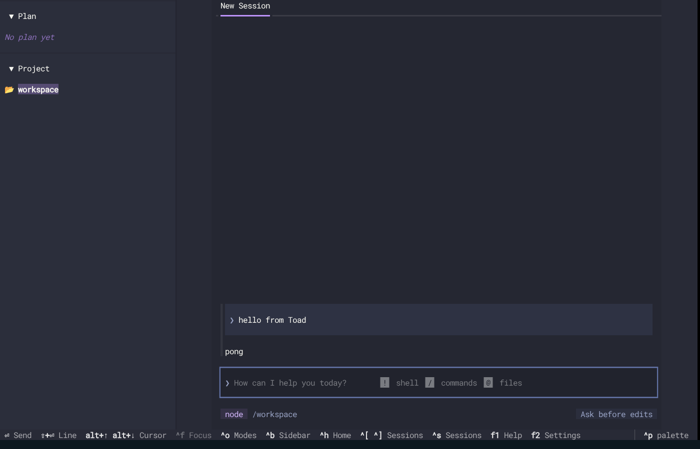

# node-pty prebuild fix — end-to-end evidence

Evidence for [`mruderman/letta-code:fix/node-pty-prebuilds`](https://github.com/mruderman/letta-code/tree/fix/node-pty-prebuilds),
which revives closed letta-ai/letta-code#3608 (fixes letta-ai/letta-acp#50:
`npx @letta-ai/letta-acp` fails on Linux without a C toolchain, which keeps Letta out
of the ACP Registry). This branch holds only test material: the plan
([`TEST-PLAN.md`](TEST-PLAN.md)), reproducible [`scripts/`](scripts/), and scrubbed
[`logs/`](logs/). It shares no history with letta-code and is not meant to be merged.

**Status:** sandbox phase complete (all checks pass). Pending: Letta's own CI on the
fork, and the live-agent runs (OpenAI model, incl. Toad).

## Under test

| Component | Version / ref |
|---|---|
| letta-code (fix) | `fix/node-pty-prebuilds` @ `bb0e02c`, on letta-ai `main` @ `e2b62e2` (0.34.35); test build published as `0.34.99` |
| letta-acp | letta-ai `main` @ `4b0a571`, with `@letta-ai/letta-code` → `0.34.99` and `@letta-ai/letta-agent-sdk` → `0.8.64` bumped together; test build `0.1.99` |
| node-pty | `1.2.0-beta.14`, delivered through letta-code's published `npm-shrinkwrap.json` |
| ACP Registry validator | agentclientprotocol/registry `main` @ `8c75170`, Letta entry from registry#472 |
| Third-party client | Toad `0.6.20` (batrachian.ai) |
| ACP client SDK (scripted client) | `@agentclientprotocol/sdk` `1.3.0` (same as letta-acp) |

Test builds are served from a throwaway Verdaccio where `@letta-ai/letta-code` and
`@letta-ai/letta-acp` exist **only** as the local test versions, so every install is
provably the build under test.

## Results — sandbox phase (no credentials)

| # | Check | Environment | Result | Logs |
|---|---|---|---|---|
| 1 | ACP Registry validator, **published** `letta-acp@0.1.11` | registry image (Ubuntu 24.04, no make, Node 22.23.4) | ✗ fails: `node-pty@1.1.0` install runs `node-gyp rebuild` → `code: 1`; validator reports an initialize timeout | [`registry-before.log`](logs/sandbox/registry-before.log), [npm debug](logs/sandbox/registry-before-npm-debug.log) |
| 2 | ACP Registry validator, **fixed** chain | same | ✓ `Auth OK: letta-login(terminal)` | [`registry-after.log`](logs/sandbox/registry-after.log) |
| 3 | Full ACP pipeline via `npx` (adapter → SDK → app-server → local backend → turn), deterministic executor | registry image (glibc) | ✓ | [`det-glibc/`](logs/sandbox/det-glibc/) |
| 4 | same | `node:22-alpine` (musl) | ✓ | [`det-musl/`](logs/sandbox/det-musl/) |
| 5 | `exec_command` PTY path (`startShellProcess`): real PTY, stdin round-trip | registry image (glibc) | ✓ `tty=true`, `PTY_OK`, `got:hello` | [`pty-smoke-glibc.json`](logs/sandbox/pty-smoke-glibc.json) |
| 6 | Websocket terminal (`handleTerminalSpawn`/`Input`) | registry image (glibc) | ✓ shell evaluated typed `echo TERM_$((40+2))` → `TERM_42` | same file |
| 7 | `exec_command` on musl: glibc prebuild refused | `node:22-alpine` | ✓ `tty=false`, ran via pipe (`NO_PTY`), reason on stderr, no crash | [`pty-smoke-musl.json`](logs/sandbox/pty-smoke-musl.json) |
| 8 | Websocket terminal on musl | `node:22-alpine` | ✓ clean `terminal_exited` naming musl, no segfault | same file |
| 9 | **Toad** (independent ACP client) launches letta-acp, session + prompt turn | registry image | ✓ `end_turn`; screenshot shows prompt and reply | [`toad-det/`](logs/sandbox/toad-det/) |

In every environment above, node-pty installed **from its prebuild** (no `build/`
directory) with **no** `make` or compiler present.



## Coverage map

| What the fix touches | Covered by |
|---|---|
| `npx` install without build tools | 1–4, 9 (and every container run) |
| Published shrinkwrap pins node-pty for consumers | 3–9 install letta-code/letta-acp from the registry, not from source |
| `exec_command` `tty: true` + `write_stdin` | 5, 7; live: scenario `pty` (pending) |
| Websocket terminal handler | 6, 8 (driven via a recording socket, not a live app-server connection) |
| musl degrades instead of segfaulting | 4, 7, 8 |
| Real model choosing the PTY path through ACP | live runs (pending) |
| macOS, Windows ConPTY, linux/arm64 | Letta's CI on the fork (pending) — arm64 emulation is unavailable in this sandbox (no `binfmt_misc`) |

## Deviations (all test-environment only)

1. **TLS CA layer.** This sandbox intercepts TLS, so the registry image gets one
   extra `COPY` of the sandbox CA bundle ([`25-registry-images.sh`](scripts/25-registry-images.sh)
   prints the exact diff). Skipped automatically when `EXTRA_CA_BUNDLE` is unset.
2. **Verdaccio redirect.** The validator overrides `HOME` and runs
   `npm exec --prefix <sandbox>`, which relocates user and global npm config; only
   npm's builtin config stays put, so the "after" image sets the registry there.
3. **Alpine prerequisites.** `node:22-alpine` lacks `git` and `bash`, which
   letta-code's local backend needs; the musl runs install both. (See findings.)
4. **Terminal handler without transport.** Checks 6 and 8 call the real handler
   functions with a recording socket.
5. **Toad live run pre-approves tools** (`LETTA_ACP_PERMISSION_MODE=unrestricted`)
   so the scripted UI session is not blocked on a dialog; permission prompts are
   exercised by the scripted client instead.

## Findings beyond the fix

- **The published shrinkwrap decides node-pty for consumers.** `main` now publishes
  `npm-shrinkwrap.json`, which still locked `node-pty@1.1.0`; the fix updates that
  entry (4 lines) and the `lettaRuntimeGraphSha512` digest.
- **Alpine needs `git` and `bash` for the local backend** (`spawn git ENOENT`, then
  the memory store's git hook fails with `env: can't execute 'bash'`). Unrelated to
  node-pty; worth a line in docs.
- **`LETTA_LOCAL_BACKEND_EXECUTOR=deterministic` answers `pong` and calls no
  tools** (`DeterministicPongExecutor`), so tool execution through ACP is covered
  by the live runs rather than deterministically.

## Reproduce

```bash
export E2E_WORK=/tmp/letta-e2e LETTA_CODE_DIR=~/letta-code LETTA_ACP_DIR=~/letta-acp REGISTRY_DIR=~/acp-registry
# Only in sandboxes that intercept TLS:
# export EXTRA_CA_BUNDLE=/path/to/ca-bundle.crt
bash e2e/scripts/run-sandbox.sh                         # this table's checks 1–9
OPENAI_API_KEY=... bash e2e/scripts/90-live-all.sh      # live-agent runs
bash e2e/scripts/95-collect-logs.sh <label>             # copy + scrub logs here
```

Clones: letta-code with `fix/node-pty-prebuilds` checked out as a branch, letta-acp
`main`, and agentclientprotocol/registry `main`. Requires Docker, Bun, Node, Python 3.

## Continuing in a new session (live runs)

The OpenAI key is a session secret (`OPENAI_API_KEY_OR_ACCESS_TOKEN`), visible only
in sessions started after it was added. In a new session:

1. Clone `mruderman/letta-code` (branches `fix/node-pty-prebuilds` and
   `e2e-evidence`), `letta-ai/letta-acp`, and `agentclientprotocol/registry`
   (fetch `pull/472/head` as `pr-472`).
2. Start Docker (`dockerd`), set the env above, run `run-sandbox.sh`.
3. Run `90-live-all.sh` (maps the secret itself; stops if OpenAI rejects it).
4. Run `95-collect-logs.sh live`, update the results here, commit to `e2e-evidence`.

Ground rules: nothing is posted to any `letta-ai` repository; every live run creates
a fresh agent in a throwaway directory; failures are reported as failures.
